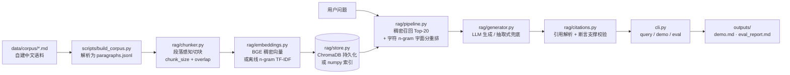

# minimal-rag-cn

一个可离线跑通的中文 RAG（检索增强生成）最小实现：自建中文技术语料 → 段落感知切块 → 向量检索 → **强制引用**生成 → 断言级引用校验 → 30 题自动评测。

面向「企业知识库问答」这类场景的最小可运行骨架，重点不是堆模型，而是把**证据链是否可核验**做成可执行、可评测的代码。

## 这个项目能证明什么

- 能把 RAG 拆成可独立测试的模块：切块、向量化、向量库、检索、生成、引用校验、评测。
- 设计了强制引用与**断言级支撑校验**：不只检查引用编号存在，还检查每条结论能否在被引用的块里找到依据（含负例测试）。
- 在无外网、无模型权重、无 API Key 的环境下仍能跑通完整链路，并把降级行为显式暴露给使用者。
- 自建 30 题评测集，输出命中率@K、MRR、答案正确率、引用命中率、断言支撑率，并与「关闭引用约束」的基线做同条件对比。

## 架构



## 目录结构

```
minimal-rag-cn/
├── cli.py                  # 命令行入口：build / query / demo / eval
├── data/
│   ├── corpus/             # 7 篇自建中文技术文档（Markdown 源）
│   ├── paragraphs.jsonl    # 脚本解析出的段落（带稳定 ID）
│   └── eval_qa.jsonl       # 30 条评测问答（问题、答案关键词、标准来源片段）
├── rag/
│   ├── config.py           # 参数与环境变量
│   ├── chunker.py          # 段落感知切块 + 重叠窗口
│   ├── embeddings.py       # BGE 稠密向量 + 离线 n-gram 哈希 TF-IDF 兜底
│   ├── store.py            # ChromaDB + numpy 索引兜底
│   ├── pipeline.py         # 检索 → 生成 → 校验
│   ├── generator.py        # LLM（OpenAI 兼容）+ 抽取式兜底
│   ├── citations.py        # 引用解析与断言支撑校验
│   └── evaluate.py         # 指标计算与报告渲染
├── scripts/build_corpus.py # 语料 → 段落
├── tests/test_rag.py       # 切块 / 向量 / 引用校验单元测试（含负例）
├── outputs/                # 真实运行产物：demo.md、eval_report.md、eval_details.json
├── requirements.txt        # 核心依赖：numpy
└── requirements-optional.txt # 可选：sentence-transformers、chromadb
```

## 快速开始

```bash
git clone https://github.com/Jamorlant/minimal-rag-cn.git
cd minimal-rag-cn
pip install -r requirements.txt          # 仅 numpy，即可跑离线兜底链路
python scripts/build_corpus.py          # 语料 -> data/paragraphs.jsonl
python cli.py build                     # 切块 + 向量化 + 建索引（索引写入 index/）
python cli.py demo                      # 一键演示，结果写入 outputs/
python cli.py eval                      # 30 题评测，报告写入 outputs/eval_report.md
python cli.py query "并查集的路径压缩做了什么？" --k 3
python -m unittest discover -s tests    # 单元测试
```

启用稠密向量与 ChromaDB（可选）：

```bash
pip install -r requirements-optional.txt
python cli.py build      # 自动优先使用 BAAI/bge-small-zh-v1.5 + ChromaDB
```

首次加载 BGE 需要下载模型权重（约 95 MB）；下载成功后会在 HuggingFace 缓存中离线复用，不会再次联网。若下载失败会自动降级为字符 n-gram TF-IDF，流程不中断。

### 常用参数

| 参数 | 默认值 | 说明 |
| --- | --- | --- |
| `--chunk-size` / `RAG_CHUNK_SIZE` | 280 | 切块字符上限 |
| `--overlap` / `RAG_CHUNK_OVERLAP` | 56 | 块间重叠字符数 |
| `--k` / `RAG_TOP_K` | 3 | 检索返回条数 |
| `RAG_EMBED_MODE` | auto | `auto` / `st`（强制稠密）/ `ngram`（强制离线） |
| `RAG_STORE` | auto | `auto` / `chroma` / `numpy` |
| `RAG_LLM_MODE` | auto | `auto` / `llm` / `extractive` |
| `RAG_LLM_API_KEY` | 空 | 配置后启用 LLM 生成（OpenAI 兼容接口） |
| `RAG_RERANK_WEIGHT` | 0.5 | 稠密分占比，其余为字符 n-gram 字面分 |
| `RAG_MIN_HIT_SCORE` | 0.25 | 最佳命中分低于该值直接拒答 |
| `RAG_SUPPORT_THRESHOLD` | 0.55 | 断言支撑度阈值 |

### 为什么是混合检索

纯稠密向量在术语型问题上会「懂大意但排不准」：本语料实测 Top-3 命中率 90%，而加入字面分后升到 96.67%。做法是先用 BGE 召回 20 个候选块，再用字符 n-gram TF-IDF 余弦做重排，`0.5 × 稠密分 + 0.5 × 字面分` 取前 K。字面分不依赖模型权重，索引加载时在内存里算一次即可。

## 引用校验怎么做

1. 答案按行、再按中文句末标点拆成**独立断言**；
2. 每条断言取字符二元组与一元组集合，与被引用块文本求覆盖率，`0.5 × 二元覆盖率 + 0.5 × 一元覆盖率` 作为支撑度；
3. 支撑度 ≥ 阈值记为「已支撑」，否则「未支撑」；未标注引用的断言直接记为「未支撑」；
4. 引用编号不在本次召回集合中的，单独记为「越界引用」。

这能识别「引用编号正确但内容与该块无关」的形式正确、实质错误的情况——单元测试里专门构造了这个负例。校验口径的代价是：对大幅改写的答案偏严格，可能把正确改写判为未支撑。

## 评测结果（真实运行）

运行环境：Python 3.13 / Windows，`BAAI/bge-small-zh-v1.5`（512 维，CPU）+ ChromaDB 1.5.9 + 离线字面重排。配置：946 段落 / 35,921 字（约 48 页，按 750 字/页折算）/ 337 个块；chunk_size=280，overlap=56；30 道中文问答题（事实 26、条件 4）；断言阈值 0.55。

| 配置 | Top-K | 命中率@K | MRR | 答案正确率 | 引用命中率 | 断言支撑率 | 平均耗时 |
| --- | --- | --- | --- | --- | --- | --- | --- |
| 基线（Top-1，无引用约束） | 1 | 80.00% | 0.800 | 76.67% | 0.00% | 0.00% | 72.9 ms/题 |
| 完整（Top-3，强制引用 + 校验） | 3 | 96.67% | 0.867 | 76.67% | 80.00% | 100.00% | 74.4 ms/题 |

指标口径：

- **命中率@K**：Top-K 召回块中是否有块的来源段落命中标准来源。
- **MRR**：第一个命中块的名次倒数均值。
- **答案正确率**：答案包含该题全部标注关键词（关键词来自标准答案，评测前固定，不随生成结果调整）。
- **引用命中率**：答案中至少一个被引用块的来源命中标准来源的题目占比；基线不产生引用，故为 0。
- **断言支撑率**：全部断言中被判为「已支撑」的比例；基线无引用，断言无法核验，故为 0。

当次完整明细见 [outputs/eval_report.md](outputs/eval_report.md) 与 [outputs/eval_details.json](outputs/eval_details.json)。

关于这两行数字，有两点必须说清楚：

1. 抽取式生成的答案句与基线相同（都取最相关块中最匹配的一句），所以两行**答案正确率相同**。差别在 Top-3 召回（96.67% vs 80%）与「每条结论都带可核验引用」：完整流程下 80% 的题引用命中标准来源、100% 的断言能在被引块中找到依据。
2. 抽取式答案本身就是原文摘录，支撑率必然接近 100%，这个数字**不能**当作生成质量。校验器真正的作用对象是 LLM 生成的自然语言答案——开启 `RAG_LLM_API_KEY` 后再跑 `eval` 才能看到它在改写型答案上的判定效果（单元测试里已覆盖「引用编号正确但内容无关」的负例）。

失败样本集中在：问法与原文用词差异大（如「并查集的路径压缩具体做了什么」标准块未进 Top-3）、抽取式只能摘一句导致多要点问题答不全。

## 降级方案一览

| 环节 | 默认方案 | 兜底方案 | 触发条件 | 影响 |
| --- | --- | --- | --- | --- |
| 向量化 | `BAAI/bge-small-zh-v1.5`（sentence-transformers） | 字符 2/3-gram + 稳定哈希 + IDF 加权 + L2 归一化的 TF-IDF 向量 | 包缺失、权重下载失败或本地无缓存 | 无语义泛化能力，同义改写召回弱；纯 numpy 可离线复现 |
| 向量库 | ChromaDB 本地持久化（cosine） | numpy 全量矩阵点积 + `argsort` | chromadb 导入失败 | 万级块以内可用；无增量写入与近似检索 |
| 生成 | LLM（OpenAI 兼容）强制引用 | 抽取式：在最相关块内按相似度选一句，返回原文并附块编号与摘录 | 未配置 `RAG_LLM_API_KEY` | 表达自然度低、只能答单要点，但零幻觉、引用必然指向原文 |

三者都会在启动、`build` 输出、`outputs/demo.md` 与索引 `index/meta.json` 中显式标注，不静默降级。

## 语料说明与许可

- 语料位于 `data/corpus/`，共 7 篇：数据结构与算法笔记、算法设计与分析手册、Python 数据处理手册、中文文本处理与检索基础、SQL 与数据建模基础、接口集成与自动化工程实践、Git 与工程协作实践。
- 全部文本由本项目脚本化组织与人工撰写，**不使用任何真实企业文档、客户资料或个人信息**，不包含姓名、手机号、邮箱、住址、学校与真实公司名称。
- 语料以 MIT 许可随本仓库发布，可自由用于演示、评测与二次修改。
- 段落 ID 由 `scripts/build_corpus.py` 按文件顺序稳定生成；评测集通过唯一原文片段绑定标准来源，绑定失败会在评测开始时直接报错。

## 局限与未做到的部分

1. **评测集是自建的、单一的**：30 题由我一人出题并标注来源片段，没有第二人复核，题目风格集中于「术语定义 + 参数取值」，不代表真实用户提问分布；指标只能横向对比本项目内的两行配置，不能与公开榜单相比。
2. **抽取式生成只是兜底**：答案取最相关块中最匹配的一句原文，不做归纳、比较与多跳推理，多要点问题只能答一半；跨块信息组合完全没有覆盖。
3. **断言校验是覆盖率近似**：字符级覆盖率能识别无关引用，但无法判断数值、否定与因果是否被曲解；对大幅改写的正确内容会偏严。
4. **LLM 分支未做端到端实测**：本机没有可用的 `RAG_LLM_API_KEY`，LLM 生成路径只有代码与提示词，没跑过真实 API；上表全部为抽取式结果。BGE 与 ChromaDB 分支是实测的（`index/meta.json` 里 `degraded=false`）。
5. **拒答阈值靠经验调参**：`RAG_MIN_HIT_SCORE=0.25` 在本语料上区分开了示例中的不可答题，但相邻分数（0.23~0.27）区间仍可能误答或误拒，没有做系统性拒答评测。
6. **未做权限隔离、增量索引与并发服务化**：当前是单机离线脚本，没有用户体系、鉴权、增量更新与在线 QPS 保障。

## License

MIT
