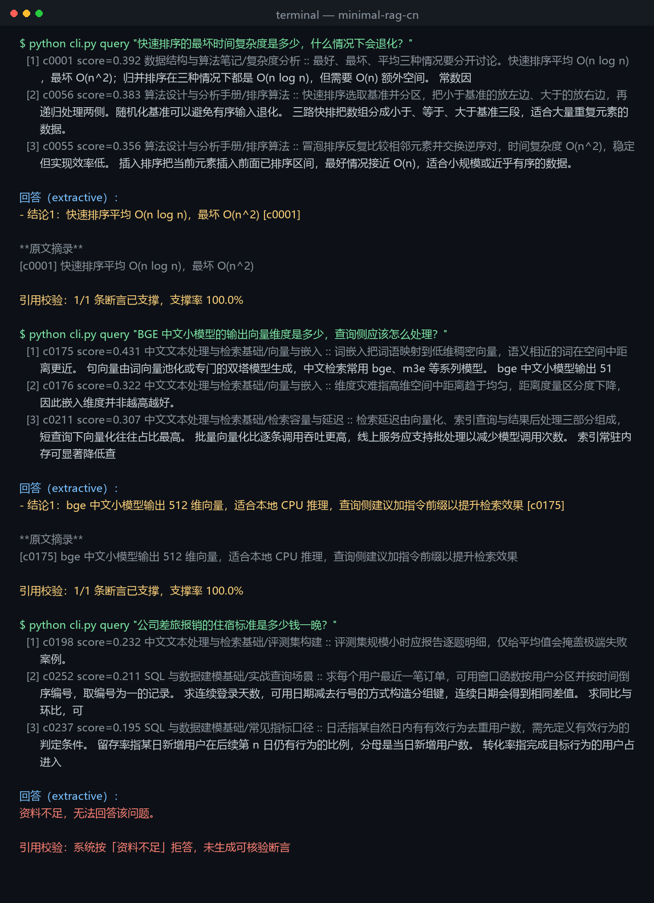
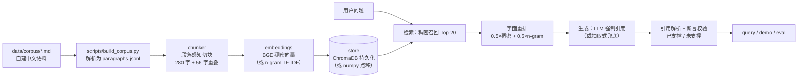

# minimal-rag-cn

**一个不依赖 RAG 框架的中文参考实现：每条结论都带可核验引用，答不出来就拒答。**

面向企业知识库问答场景，用 1 份自建 48 页中文技术语料 + 30 道人工标注题，把「切块 → 稠密召回 → 字面重排 → 强制引用生成 → 断言校验」整条链路跑通并量化。默认 `BAAI/bge-small-zh-v1.5` + ChromaDB；缺模型权重、缺 chromadb、缺 LLM Key 时全部显式降级，不静默失败。

**同一套问题，两种配置的真实结果（本机实测，非估算）**

| 配置 | Top-K | 命中率@K | MRR | 答案正确率 | 引用命中率 | 断言支撑率 |
| --- | --- | --- | --- | --- | --- | --- |
| 基线：Top-1，不做引用约束 | 1 | 80.00% | 0.800 | 76.67% | 0.00% | 0.00% |
| 完整：Top-3 + 强制引用 + 断言校验 | 3 | **96.67%** | **0.867** | 76.67% | **80.00%** | **100.00%** |

<sub>30 题中文问答 / 946 段落 / 337 个块 / chunk_size=280 / overlap=56 / 断言阈值 0.55。逐题明细：[outputs/eval_report.md](outputs/eval_report.md) · 原始数据：[outputs/eval_details.json](outputs/eval_details.json)</sub>



```bash
pip install -r requirements.txt -r requirements-optional.txt
python cli.py build      # 切块 + 向量化 + 建索引
python cli.py demo       # 4 个示例写入 outputs/，含一个不可答题触发拒答
```

> 只有 `numpy` 也能跑：`pip install -r requirements.txt && python cli.py demo` 会自动走离线 n-gram 向量 + numpy 索引。

---

## 解决什么问题

企业问答最容易出事的两件事，恰好都不是「检索不准」：

1. **答案没有出处**：模型说得像真的，但没人能快速核对到原文哪一句。
2. **强行作答**：资料里没有的内容，模型也要编一段。

本项目把这两点做成硬约束：答案的每条结论必须标注 `[c0001]` 形式的块编号，并由**断言校验器**反向检查「这句话能否在被引用的块中找到支撑」，输出「已支撑 / 未支撑」；检索分低于阈值直接拒答，而不是凑一个答案。

## 架构



更细的模块职责、数据流与设计取舍见 [docs/architecture.md](docs/architecture.md)。

## 降级路径：显式标注，不静默降级

三个外部依赖都可能在面试机/离线环境里缺失。项目对每一种都准备了**可跑的替代实现**，并且把降级状态写进启动输出、`index/meta.json`、`outputs/demo.md`、`outputs/eval_report.md`，读者一眼能看出这份结果是在什么条件下产生的。

| 能力 | 首选 | 降级实现 | 触发条件 | 降级后损失 |
| --- | --- | --- | --- | --- |
| 向量化 | `BAAI/bge-small-zh-v1.5`（512 维） | 字符 2/3-gram + 稳定哈希 + IDF 加权 + L2 归一化 | 包缺失 / 权重下载失败 / 本地无缓存 | 无语义泛化，同义改写召回变弱 |
| 向量库 | ChromaDB 本地持久化（cosine） | numpy 全量矩阵点积 + argsort | chromadb 导入失败 | 仅适合万级块以内，无近似检索 |
| 生成 | LLM（OpenAI 兼容接口） | 抽取式：最相关块内选句，附块编号与原文摘录 | 未配置 `RAG_LLM_API_KEY` | 表达生硬、只能答单要点，但零幻觉 |

设计原则：**降级只降能力，不降可信度**。所有降级都会在 `note` 字段里写明原因（含异常类型），并在 CLI 输出前缀 `!` 或 `提示：`，避免「看起来跑通了，其实换了实现」。

## 快速启动

```bash
# 1. 安装（仅离线模式也可以只装 requirements.txt）
pip install -r requirements.txt -r requirements-optional.txt

# 2. 构建索引（首次会下载 BGE 权重，约 95 MB）
python cli.py build

# 3. 一键演示：3 个可答题 + 1 个不可答题（触发拒答）
python cli.py demo
```

其他命令：

```bash
python cli.py query "快速排序的最坏时间复杂度是多少？"   # 单问
python cli.py eval                                    # 30 题评测 + 基线对比
python -m unittest discover -s tests                   # 单元测试
```

环境变量与可调参数见 [.env.example](.env.example)，全部可选；不配置也能跑。

## 技术选型理由

| 选择 | 理由 | 代价 |
| --- | --- | --- |
| 段落感知切块 + 标题边界 | 中文技术文档的语义单位是段落；按块硬切会把答案切在两块之间 | 长段落仍需句级二次切分 |
| `bge-small-zh-v1.5` | 512 维、CPU 可跑、中文检索效果稳定，权重仅 95 MB | 长块内语义被稀释，纯稠密 Top-3 只有 90% |
| 稠密 + 字面混合重排 | 术语型问题（如 `merge`、`HNSW`）需要字面命中，纯语义会漂移；实测 90% → 96.67% | 多一次 n-gram 计算（< 5 ms） |
| ChromaDB | 本地持久化、零服务部署、cosine 直接用 | 大库需换 HNSW/FAISS |
| 字符 n-gram 兜底 | 不依赖分词词典与模型下载，跨进程可复现（稳定哈希） | 无同义能力 |
| 抽取式兜底 | 无 API Key 仍能演示「引用 + 校验」闭环，且答案零幻觉 | 只能摘一句原文，不能归纳 |

刻意没有引入的东西：LangChain / LlamaIndex（链路只有 5 步，直接写更透明）、FastAPI 服务层（作品集阶段先证明链路正确）、向量数据库服务端（本地场景 ChromaDB 足够）。

## 目录结构

```
.
├── cli.py                  # 命令行入口：build / query / demo / eval
├── rag/
│   ├── config.py           # 配置（环境变量 + .env，无硬编码密钥）
│   ├── chunker.py          # 段落感知切块、重叠窗口
│   ├── embeddings.py       # BGE 稠密向量 / n-gram TF-IDF 兜底
│   ├── store.py            # ChromaDB / numpy 向量库
│   ├── index.py            # 建索引、加载索引
│   ├── pipeline.py         # 检索 + 混合重排 + 生成 + 校验编排
│   ├── generator.py        # LLM 生成 / 抽取式兜底
│   ├── citations.py        # 引用解析、断言支撑校验
│   ├── evaluate.py         # 指标计算与报告输出
│   ├── textutil.py         # 中文规范化、n-gram、覆盖率
│   └── logging_utils.py    # 统一日志级别
├── data/
│   ├── corpus/*.md         # 7 篇自建中文技术文档（原创，无真实主体）
│   ├── paragraphs.jsonl    # 构建产物：946 个段落
│   └── eval_qa.jsonl       # 30 道人工标注题
├── scripts/build_corpus.py # Markdown → paragraphs.jsonl
├── tests/test_rag.py       # 切块 / 兜底向量 / 引用校验单测
├── docs/                   # 架构说明、截图、PR 模板
├── outputs/                # demo 与评测的真实运行产物
├── .github/workflows/ci.yml
├── Makefile
├── pyproject.toml          # ruff / pytest 配置
└── .env.example
```

## 已知限制

1. **抽取式答案导致基线/完整的答案正确率相同（76.67%）**：两行用的是同一句原文，差别在 Top-3 召回、引用与校验。这不是笔误，也不打算为了表格好看而删。
2. **100% 断言支撑率不代表生成质量**：抽取式答案本身就是原文摘录，支撑必然成立；校验器的真正对象是 LLM 改写后的答案。无 Key 的环境下这一列只证明「校验链路通」。
3. **LLM 分支未做端到端实测**：本机没有可用 Key，只有代码与提示词，没跑过真实 API。
4. **抽取式只能答单要点**：不做归纳、比较与跨块多跳；多要点问题只能答一半。
5. **断言校验是字符覆盖率近似**：识别得了无关引用，判断不了数值、否定与因果是否被曲解；对大幅改写的正确内容偏严。
6. **评测集小且单人标注**：30 题、无第二人复核，题型集中在术语定义与参数取值，不能与公开榜单横向比较。
7. **拒答阈值靠经验调参**：`0.25` 在本题集上分开了不可答题，0.23~0.27 的邻界区间仍可能误答或误拒。
8. **无权限隔离、增量索引、并发服务**：单机离线脚本，不是线上服务。

## 评测方法

- 指标：命中率@K、MRR、答案正确率（关键词全含）、引用命中率、断言支撑率、拒答数、平均耗时。
- 标准来源用「唯一原文片段」绑定段落 ID，评测前校验片段必须能在语料中找到，防止标注与语料漂移。
- 基线 = 同一检索链路取 Top-1、关闭引用约束；完整 = Top-3 + 强制引用 + 校验。两行同一进程、同一语料、同一批题。

## 语料与许可

- `data/corpus/` 为自行撰写的 7 篇中文技术笔记（数据结构、算法、Python 数据处理、文本检索、SQL 建模、接口集成、Git 协作），无姓名、手机号、邮箱、学校、住址，无真实公司/客户名称。
- `data/eval_qa.jsonl` 为配套的 30 道题与标准来源片段，人工标注。
- 代码与语料均以 MIT 许可发布，见 [LICENSE](LICENSE)。

## 文档

- [docs/architecture.md](docs/architecture.md)：模块职责、数据流、失败处理与设计取舍（给面试官）
- [docs/PR_TEMPLATE.md](docs/PR_TEMPLATE.md)：PR 描述模板
- [outputs/demo.md](outputs/demo.md)：真实 demo 输出
- [outputs/eval_report.md](outputs/eval_report.md)：真实评测报告
